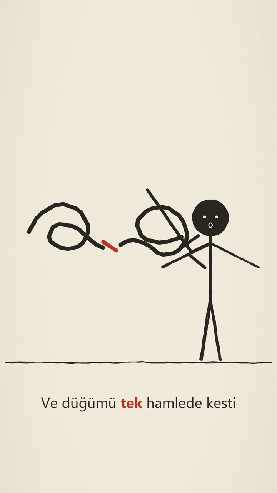

# Stickman Explainer

Codex skill for producing vertical, hand-drawn stick-figure explainer videos from a storyboard and voice-over.

## Included

- `stickman-explainer/` — the updated skill, renderer, style guide, and example storyboard.
- `examples/gordion-explainer.mp4` — the rendered Gordion Knot explainer.
- `examples/gordion-reference-frame.png` — a still extracted from the video.

The skill includes speech-timed word highlighting, accessory-free default figures, and drawing guidance for readable knots, swords, and visibly separated cut rope ends.

## Install

Copy `stickman-explainer/` into your Codex skills directory, usually `~/.codex/skills/`.

## Example

[Watch the full video](examples/gordion-explainer.mp4)

